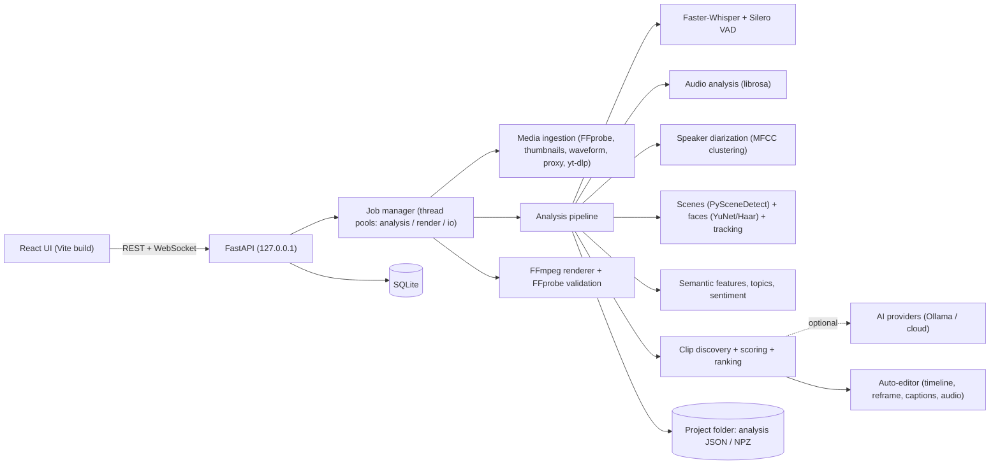

# Architecture

| Module (spec) | Code |
|---|---|
| Frontend | `frontend/src` |
| FastAPI backend | `backend/app/main.py`, `backend/app/api/*` |
| Media ingestion | `services/media.py`, `pipeline.handle_import / handle_download / handle_proxy` |
| Transcription | `services/transcription.py`, `services/segmentation.py` |
| Audio analysis | `services/audio_analysis.py` |
| Scene analysis | `services/vision.py` (`detect_scenes`, `sample_frames`, `track_faces`) |
| Speaker analysis | `services/diarization.py`, `vision.speaker_positions` |
| AI intelligence | `services/semantic.py`, `services/llm.py` |
| Clip discovery | `services/discovery.py` |
| Video editing engine | `services/autoedit.py`, `services/reframe.py` |
| Caption engine | `services/captions.py` |
| Audio mixing | `services/renderer.py` (voice chain, music ducking, SFX, loudnorm), `services/audio_library.py`, `services/audio_synth.py` |
| FFmpeg rendering | `services/renderer.py` |
| Project management | `api/projects.py`, `services/storage.py`, `models.py` |
| Job queue | `jobs.py`, `events.py` |
| Local model manager | `api/ai.py` (`/api/models`), `transcription.download_model`, `vision.download_yunet` |
| Export management | `api/exports.py`, `pipeline.handle_render` |

## Data layout

`%LOCALAPPDATA%\ClipForgeAI\` – `clipforge.db` (SQLite, WAL), `settings.json`, `secrets.bin` (DPAPI), `models\`, `logs\`,
`audio_library\` (user imports), `projects\<id>\{media, analysis, thumbs, proxy, renders}`.

Analysis artifacts are cached per stage (`audio.wav`, `transcript.json`, `audio.json` + `audio_frames.npz`, `diarization.json`,
`vision_proxy.mp4`, `scenes.json`, `vision.json`, `semantic.json`) so re-running, resuming an interrupted job or re-discovering with
new durations never repeats expensive work unnecessarily.

## Replacing AI providers

* ASR: `transcription.transcribe()` returns a plain dict (`words`, `sentences`, `language`…). Any engine producing the same structure can be dropped in.
* LLM: `llm.chat_json()` is the single provider entry point; add a new `kind` there and in `PROVIDER_KINDS`.
* Face detection: `vision.FaceDetector.detect()` returns normalized boxes; swap the detector without touching reframing.
